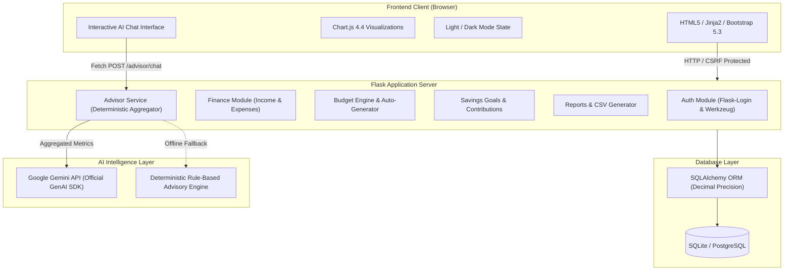

# FinWise AI: Personal Finance Advisor Bot
> **"Your money. Your goals. Your future."**  
> *A Complete Full-Stack AI-Powered Financial Management & Advisory Web Application.*  
> **Academic Engineering Capstone Project**

[](https://www.python.org/)
[](https://flask.palletsprojects.com/)
[](https://www.sqlalchemy.org/)
[](https://ai.google.dev/)
[](LICENSE)

---

## 1. Project Abstract & Overview

**FinWise AI** (academic title: *Personal Finance Advisor Bot*) is a production-grade, full-stack personal finance web application built with **Python, Flask, SQLAlchemy, Chart.js, and Google Gemini Gen AI**. 

Modern individuals and students often struggle with financial literacy, unmonitored lifestyle inflation, and delayed savings goals. Traditional finance tools are either overly complex accounting software or passive tracking spreadsheets that offer zero guidance. **FinWise AI** bridges this gap by combining **deterministic financial calculations** (using Python Decimal precision) with an **intelligent AI advisory engine** (using the official Google GenAI Python SDK and a rule-based fallback).

---

## 2. Key Features

### 🌟 Core Capabilities
1. **Multi-Source Income Management**:
   - Track Salary, Freelance, Allowance, Business, Investments, and custom inflows.
   - Month-wise and source-wise filtering with server-side validation.
2. **Precision Expense Tracking**:
   - 13 system default categories + custom user categories with distinct color coding.
   - Filter by date range, payment method (UPI, Credit Card, Debit Card, Cash, Net Banking), and merchant search.
   - Weekly velocity and monthly burn summaries.
3. **Budget Planning Engine**:
   - Category budget limits with a 4-tier visual progress indicator:
     - **Normal** (< 75%)
     - **Approaching Limit** (75% – 89.9%)
     - **Near Limit** (90% – 100%)
     - **Overspending** (> 100%)
   - **Rule-Based Budget Generator**: Generates suggested budget limits tailored to your income and occupation (Student, Salaried Professional, Freelancer, Household Manager) without exceeding available income.
4. **Savings Goals & Milestone Velocity**:
   - Track goals (Emergency Fund, Laptop, Travel, Vehicle, Custom).
   - Atomic contribution logging without double-counting expense money.
   - Real-time monthly contribution estimator based on target dates.
5. **AI Financial Advisor (Google Gemini 2.5 + Rule Engine)**:
   - Evaluates a 0–100 **Financial Health Score**.
   - Generates personalized spending habit analysis, emergency buffer guidance (3-month and 6-month calculations), and next-month actionable steps.
   - **Interactive Financial Q&A Chat**: Ask conversational questions grounded directly in your recorded transactions.
   - **Offline Fallback Engine**: If no API key is provided or the network is unavailable, an intelligent deterministic rule-based advisory engine takes over automatically.
6. **Monthly Financial Statements & CSV Export**:
   - Month-over-month comparisons, category percentage breakdowns, and printable PDF styling.
   - One-click export for **Transactions CSV** and **Monthly Summary CSV**.
7. **Security & Data Isolation**:
   - Werkzeug secure password hashing, Flask-Login session management, CSRF protection via Flask-WTF, and strict tenant isolation on every database query.
8. **Modern Fintech UI/UX**:
   - Light and dark theme toggle with persistent `localStorage` preference.
   - Responsive sidebar, statistical cards, Chart.js category doughnut and 6-month cashflow bar charts.

---

## 3. System Architecture



---

## 4. Database Schema Design

The application utilizes SQLAlchemy with foreign key constraints, indexes on user IDs and dates, and `Numeric(12, 2)` columns to prevent binary floating-point roundoff errors:

- `User`: Primary account record, occupation, default currency symbol, monthly income target, monthly savings target, priorities.
- `ExpenseCategory`: System default categories and custom user tags with hex colors and icons.
- `Income`: User ID, source, amount, date, description.
- `Expense`: User ID, category ID, amount, date, payment method, merchant, notes.
- `Budget`: Unique constraint on `(user_id, category_id, month, year)`, monthly spending limit.
- `SavingsGoal`: Target amount, current saved amount, target date, completion status.
- `SavingsContribution`: Foreign key to goal, amount, date, memo note.
- `AIInsight`: Cached monthly advice and health score.

---

## 5. Technology Stack

| Layer | Technology | Purpose |
|---|---|---|
| **Backend** | Python 3.10+, Flask 3.x | Lightweight, modular WSGI application server |
| **ORM** | Flask-SQLAlchemy 3.x | Database modeling and transactional integrity |
| **Database** | SQLite (Local) / PostgreSQL | Local file database with seamless cloud PG support |
| **Authentication** | Flask-Login & Werkzeug | Secure session cookies and cryptographic password hashing |
| **Forms & Security** | Flask-WTF & WTForms | Server-side validation and CSRF token protection |
| **AI Integration** | Google Gen AI SDK (`google-genai` / `google-generativeai`) | Context-aware monthly insights & interactive chat |
| **Frontend** | HTML5, CSS3, JavaScript (ES6) | Responsive layout, modern fintech styling |
| **Templates** | Jinja2 | Server-side HTML rendering with custom filters |
| **Charts** | Chart.js 4.4 | Doughnut category charts & 6-month historical trends |
| **Testing** | pytest & pytest-flask | Automated unit, integration, and security testing |

---

## 6. Installation & Quickstart (Windows & VS Code)

### Step 1: Verify Python Installation
Open PowerShell or Command Prompt:
```powershell
python --version
```
Ensure Python 3.10 or higher is installed.

### Step 2: Navigate to Project Directory
```powershell
cd c:\Users\HP\OneDrive\Desktop\vb
```

### Quick 1-Click Launch (Windows)
Double-click `start_server.bat` in the project folder. It automatically detects Python/Anaconda, initializes the database, seeds demo data, and opens your default browser at `http://localhost:5000`!

Alternatively, follow the manual steps below:

### Step 3: Create & Activate Virtual Environment
```powershell
python -m venv venv
venv\Scripts\activate
```

### Step 4: Install Dependencies
```powershell
pip install -r requirements.txt
```

### Step 5: Configure Environment Variables
Copy the `.env.example` file to `.env`:
```powershell
copy .env.example .env
```
Open `.env` and verify the settings:
```ini
FLASK_APP=run.py
FLASK_ENV=development
FLASK_DEBUG=1
SECRET_KEY=finwise_ai_super_secret_development_key_938f82a918237b
DATABASE_URL=sqlite:///instance/finwise.db

# Optional: Add Google Gemini API Key for live AI insights
# If left blank, the built-in intelligent rule-based engine will be used automatically
GEMINI_API_KEY=
GEMINI_MODEL=gemini-2.5-flash

CURRENCY_SYMBOL=₹
CURRENCY_CODE=INR
```

### Step 6: Initialize Database & Seed Demonstration Data
Initialize the database and populate 6 months of realistic demonstration data:
```powershell
python seed_demo.py
```
This generates the demo account:
- **Email:** `demo@finwise.ai`
- **Password:** `Demo@12345`

### Step 7: Run the Application
```powershell
python run.py
```
Open your browser and navigate to:
👉 **`http://127.0.0.1:5000`**

---

## 7. Running Automated Tests

Run the full automated test suite covering authentication, user isolation, CRUD operations, calculations, overspending limits, and report generation:

```powershell
pytest -v
```

All external Gemini API calls are mocked during tests so the test suite passes offline without requiring a paid API key.

---

## 8. Public Demonstration via Ngrok

For presenting your college project to professors, evaluators, or colleagues on mobile devices or over the internet, you can create a secure HTTPS tunnel via **Ngrok**.

### Step 1: Install Ngrok
Download Ngrok from [ngrok.com](https://ngrok.com/) or install via winget / choco:
```powershell
winget install ngrok
```

### Step 2: Configure Your Ngrok Auth Token
Sign up for a free Ngrok account and link your authentication token:
```powershell
ngrok config add-authtoken YOUR_NGROK_AUTHTOKEN
```

### Step 3: Start Local Flask App
In Terminal 1:
```powershell
python run.py
```

### Step 4: Start Ngrok Tunnel
In Terminal 2:
```powershell
ngrok http 5000
```

### Step 5: Open Public URL
Ngrok will display a forwarding URL, such as:
`https://a1b2-c3d4.ngrok-free.app`
Open this URL in any browser or mobile phone to demonstrate registration, dashboard charts, budget limits, AI advisory, and CSV downloads live!

> [!IMPORTANT]
> **Demonstration Security Note**: Ngrok is intended for live demonstrations and testing. When demonstrating publicly, use the seeded demo account (`demo@finwise.ai`) rather than real personal financial credentials.

---

## 9. Common Errors & Troubleshooting

| Issue | Cause | Solution |
|---|---|---|
| `No module named 'flask'` | Virtual environment not active | Run `venv\Scripts\activate` before running scripts |
| `sqlite3.OperationalError: no such table` | Database tables not created | Run `python seed_demo.py` or `flask init-db` |
| `CSRF token missing or invalid` | Expired session or missing token | Ensure form contains `{{ form.hidden_tag() }}` |
| AI Advisor shows "Rule-Based Advisory Active" | `GEMINI_API_KEY` is empty | Set `GEMINI_API_KEY=AIzaSy...` in `.env` and restart the server |
| Port 5000 already in use | Another service is using port 5000 | Set `$env:PORT=5050` and run `python run.py` |

---

## 10. Future Scope & Enhancements

1. **SMS & Bank Statement Parsing**: Automated expense ingestion from PDF statements and transaction SMS formats.
2. **Predictive Cashflow Forecasting**: ARIMA / Prophet time-series models for predicting end-of-month liquidity balances.
3. **Receipt OCR Scanner**: Optical character recognition for physical restaurant and retail bills.
4. **Direct Investment Portfolio Sync**: Real-time integration with mutual fund and equity broker APIs.

---

## 11. Conclusion

**FinWise AI** demonstrates how combining robust full-stack software architecture (Python, Flask, SQLAlchemy) with state-of-the-art Generative AI (Google Gemini) can transform personal financial management. The application enforces data integrity with Decimal precision, guarantees user isolation, and provides a polished fintech user experience ready for academic submission and live demonstration.
